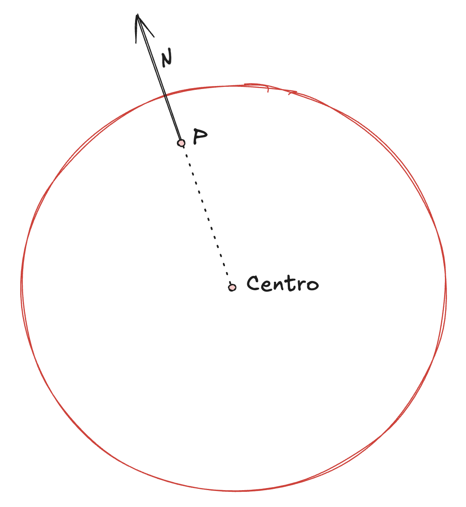

# Tarea 5 - Modelo de Luz

## Resumen de variables


| Variable | Nombre / significado | Rango de valores | Asociado a |
|---|---|---|---|
| `L` | Vector unitario desde el punto de intersección hacia la fuente de luz | Componentes reales; longitud 1 | Fuente de luz (respecto al punto de la superficie) |
| `N` | Vector normal unitario de la superficie | Componentes reales; longitud 1 | Objeto |
| `I` | Intensidad calculada en el punto | Se limita a 0 cuando `L·N < 0`; con el modelo completo, se limita a 1 | Escena / punto iluminado |
| `K_D` | Coeficiente de reflexión difusa | `[0, 1]` | Objeto |
| `I_p` | Intensidad de la fuente de luz | `[0, 1]` | Fuente de luz |
| `I_A` | Intensidad de iluminación ambiente | `[0, 1]` | Escena |
| `K_A` | Coeficiente de iluminación ambiente | `[0, 1]` | Objeto |
| `d_L` | Distancia entre el punto y la fuente de luz | `[0, +∞)` | Fuente de luz (respecto al punto de la superficie) |
| `c_1`, `c_2`, `c_3` | Coeficientes constante, lineal y cuadrático de atenuación | Valores no negativos; no se fija un máximo | Fuente de luz |
| `F_att` | Factor de atenuación por distancia | `(0, 1]` para denominador positivo | Fuente de luz (respecto al punto de la superficie) |

**Nota:** `K_D`, `I_p`, `I_A`, `K_A`, `d_L`, `c_1`, `c_2`, `c_3` y `F_att` forman parte de la descripción teórica de iluminación de este README; no son campos de `config.cfg` ni se aplican actualmente en el código. El programa solo admite esferas como tipo de objeto.

---

En el curso hemos aprendido que el modelo de luz ocupa dos vectores unitarios desde un punto P en una superficie

- El vector L, que es un vector unitario que señala de vuelta a la fuente de luz desde P
- El vector N (Normal), que es un vector unitario normal a la superficie Q en el punto P

El calculo de un vector normal es diferente para cada objeto, pues depende de la superficie en la que se encuentre

La intensidad de la luz en el punto P es directamente propocional al coseno del angulo entre L y N

Sabiendo que L y N son unitarios, lo unico que tendriamos que obtener es el producto punto entre L y N, para obtener el coseno.

```math
I = (L*N)
```

Los puntos de luz los vamos a identificar como 
```math
[x_p, y_p, z_p]
```

## Vector L

Vector L comienza desde un punto de interseccion que el ojo ve. 

Por lo tanto la primera interseccion que obtiene el ojo es `P=[x_i, y_i, z_i]`:
```math
x_1 = x_e + x_D * t_0 \\

y_1 = y_e + y_D * t_0 \\

z_1 = z_e + z_D * t_0 \\
```

Con eso, podemos obtener el vector de L el cual es:
```math
L = [(x_p-x_i), (y_p-y_i), (z_p-z_i)]
```

Sin embargo, ese vector tiene un problema, y el problema es que la resta entre el destino y origen de los puntos no siempre puede resultar en un vector unitario, por lo tanto, vamos a normalizar L para hacer que el vector resulte unitario.

```math
L = [(x_p-x_i)/||L||, (y_p-y_i)/||L||, (z_p-z_i/||L||)]
```

## Vector N para **ESFERAS** 

Este vector normal solo aplica para esferas, solamente.

Para decir verdad, es muy sencillo la teoria detras de esto, dado que es un vector que empieza desde el punto de interseccion que ve el ojo, nosotros lo que podemos hacer es obtener dicha dirección utilizando el centro de la esfera.



Es decir, solo debemos restar desde el punto de interseccion con el centro de la esfera para obtener la direccion. Como ocurrió con `L`, esta resta no va a dar un vector unitario, por lo tanto ocupamos saber la distancia, pero de hecho ya lo tenemos, es el `radio` de la esfera, con eso en mente, tenemos:
```math
N = [(x_i-x_c)/R, (y_i-u_c)/R, (z_i-z_c)/R]
```

## Intensidad - I

Inicialmente vimos que la intensidad de la luz es el producto punto de L con N
```math
I = (L‧N)
```
En caso que el producto punto dé negativo, lo forzamos a 0

## Coeficiente de Reflexion Difusa en Materiales - K_D
Un valor entre 0 y 1 asociado a cada objeto en la escena.

Se representa como K_D
```math
I = (L‧N) * K_D
```

## Intensidad de la Luz - I_p
Se quiere controlar qué tan intenso debe ser la luz

Igual sigue siendo un numero entre 0 y 1, representado como I_p

```math
I = (L‧N) * K_D * I_p
```

## Iluminacion Ambiente
Queremos controlar cuanta luz puede o cuanto rebote puede tener la luz en una escena.
Por lo tanto `I_A` representa dicho valor. Está también entre 0 y 1.

```math
I_A = [0,1] \\
I = ((L‧N) * K_D * I_p ) + I_A
```

## Coeficiente de iluminacion Ambiente
La iluminacion ambiente necesita de un coeficiente de iluminación para los objetos, que tambien está entre 0 y 1. Entre mayor sea el coeficiente, más intenso la luz ambiente en cierto objeto.

Está asociado a cada objeto de la escena, se representa de la siguiente manera

```math
K_A = [0,1] \\
I = ((L‧N) * K_D * I_p ) + (I_A*K_A)
```

## Distancia a la Luz
En la vida real, mientras más lejos se encuentra una fuente de luz, más se atenua a nuestros ojos.

Newton menciona que la luz decae de manera inversamente proporcional al cuadrado de la distancia, dicha distancia la identificamos como `d_L`.

Con eso, nosotros podemos obtener un factor de atenuacion F $_{att}$
```math
F_att = 1/(d_L^2)
```
Sin embargo no está completo, porque decae muy rápido, por lo tanto, vamos a corregirlo mintiendo más
```math
F_att = min(1.0, 1/(c_1+c_2d_L + c_3d_L^2)) \\
```
Si:
- c1=1, c2=0, c3=0 => mi fuente de luz no decae con la distancia
- c1=0, c2=1, c3=0 => se atenua linealmente
- c1=0, c2=0, c3=1 => decae cuadraticamente

Con lo anterior podemos tener 

```math
I = ((L‧N) * K_D * I_p * F_a ) + (I_A*K_A)
```
## Multiples Fuentes de Luz
Si tenemos varias fuentes de luz, tenemos que seguir un modelo aditivo, es decir, se le suman las intensidades
```math
I = ∑((L‧N) * K_D * I_p * F_a ) \\
I  = I + (I_A*K_A) \\
I = min(I, 1.0)
```

---
### Notas
- Si el coseno entre L-N es 90 grados, eso da 0, significa la minima intensidad
- Si el angulo es mayor a 90 grados, el coseno da negativo, por lo tanto vamos a ignorar la fuente de luz
